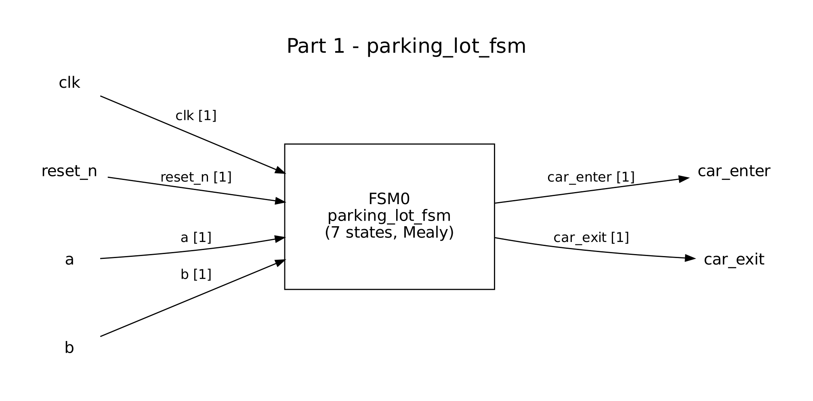
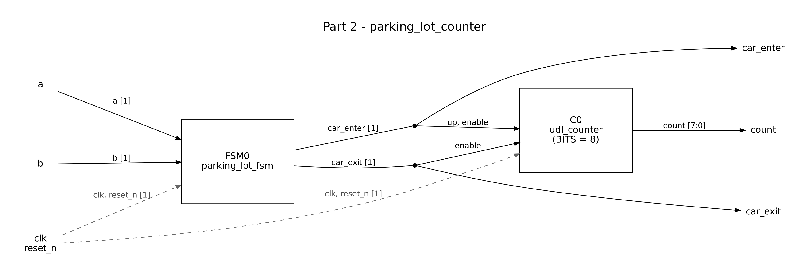
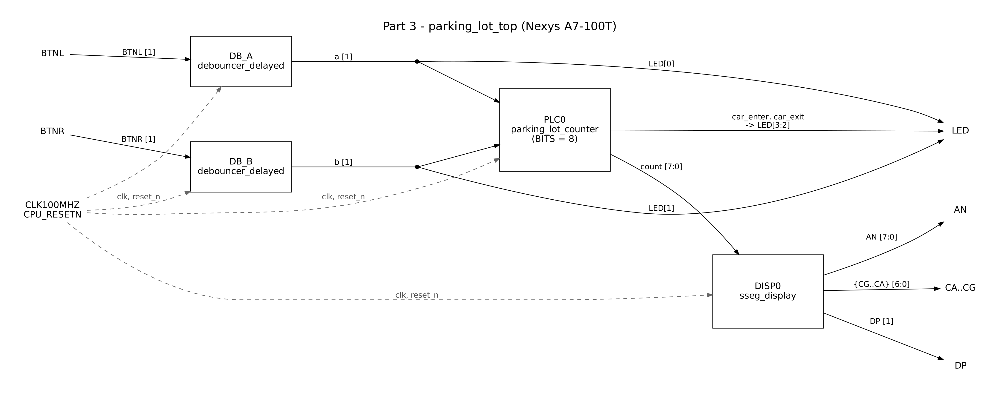

# Lab 8 – Parking Lot Occupancy Counter

**Course:** ECE 2300L – Digital Logic Design Laboratory
**Board:** Nexys A7-100T
**Tools:** Verilog, Xilinx Vivado

## Files

| File | Description |
|---|---|
| [`parking_lot_fsm.v`](verilog/design/parking_lot_fsm.v) | Mealy FSM that detects cars entering/exiting from sensors a and b |
| [`parking_lot_counter.v`](verilog/design/parking_lot_counter.v) | FSM + up/down counter that tracks the number of cars in the lot |
| [`parking_lot_top.v`](verilog/design/parking_lot_top.v) | Top module for the Nexys A7-100T |
| [`sseg_display.v`](verilog/design/sseg_display.v) | Multiplexed seven-segment display showing the count in decimal |
| [`sseg_decoder.v`](verilog/design/sseg_decoder.v) | Digit to seven-segment converter |
| [`timer_parameter.v`](verilog/design/timer_parameter.v) | Parameterized timer used by the debouncer |
| [`udl_counter.v`](verilog/design/udl_counter.v) | Starter: parameterized up/down/load counter |
| [`debouncer_delayed.v`](verilog/design/debouncer_delayed.v) | Starter: delayed pushbutton debouncer |
| [`debouncer_delayed_fsm.v`](verilog/design/debouncer_delayed_fsm.v) | Starter: delayed debouncer FSM |
| [`tb_parking_lot_fsm.v`](verilog/sim/tb_parking_lot_fsm.v) | FSM testbench (car enter, car exit, pedestrian) |
| [`tb_parking_lot_counter.v`](verilog/sim/tb_parking_lot_counter.v) | FSM + counter testbench |
| [`nexys_a7_100t.xdc`](verilog/constraints/nexys_a7_100t.xdc) | Board constraints, Nexys A7-100T |

## Part 1 – Parking Lot FSM

A 7-state Mealy FSM watches sensors a and b and pulses car_enter (00→10→11→01→00) or car_exit (00→01→11→10→00) for one clock cycle. Partial sequences such as a pedestrian return to idle without an output. Verified in simulation with a car entering, a car exiting, and a pedestrian.

**Simulation screenshot:**

**Block diagram:**

## Part 2 – Occupancy Counter

The car_enter and car_exit pulses drive a single up/down counter: car_enter counts up and car_exit counts down, and the count is held between 0 and 255. Verified in simulation with an exit from an empty lot, three cars in, one car out, and a pedestrian, ending at a count of 2.

**Simulation screenshot:**

**Block diagram:**

## Part 3 – FPGA Implementation

Two debounced pushbuttons (BTNL = a, BTNR = b) act as the sensors, and the car count is shown in decimal on the seven-segment display. CPU_RESETN resets the count to 0.

**Block diagram:**

**Demo video:**

